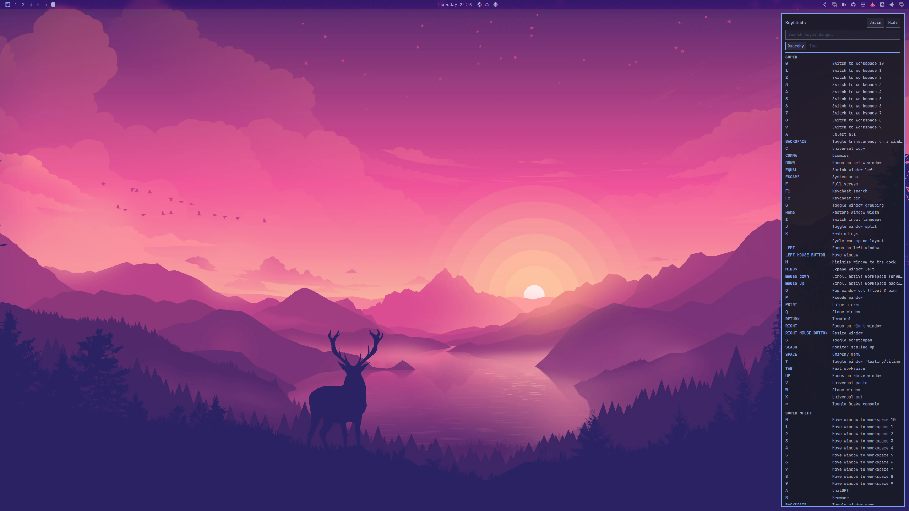

# Keycheat

An Omarchy shell plugin that keeps your keybinding cheat sheet at the edge of
the screen. It stays hidden until the pointer touches the edge, then slides out,
themed by the running Omarchy theme. Pin it to keep it open and the tiled
windows make room for it.

Three tabs share the panel: **Omarchy** (the compositor's bindings), **Tmux** and
**Neovim**. The first two come from `omarchy menu keybindings --print` and
`omarchy-menu-tmux-keybindings --print`, so your own additions in
`~/.config/hypr/bindings.lua` and `~/.config/tmux/tmux.conf` show up too, and the
lists reload when those files change. The Neovim tab is dumped from your own
config by a headless `nvim` (see [Neovim](#neovim)).



## Install

Needs Omarchy Quattro (the shell plugin system). Nothing else to install.

```bash
omarchy plugin add https://github.com/JReis23/omarchy-keycheat --enable
```

Update, disable or remove it with `omarchy plugin update|disable|remove jr.keycheat`.

## Keys and mouse

| Do this | To get this |
|---|---|
| Pointer to the screen edge | The panel slides out; move away and it slides back |
| `SUPER + F1` (after [setup](#keybinds)) | Open the panel on the focused screen with the search ready; again to close the search |
| `SUPER + F2` | Pin or unpin the focused screen |
| Type in the search field | Filter rows; every word must match, in any order (`super close` finds `SUPER + W`) |
| `↑` `↓` | Move the cursor over the rows |
| `PageUp` `PageDown` | Move a screenful |
| `Home` `End` | First or last row |
| `Enter` | Copy the selected combo (`SUPER + W`) to the clipboard |
| `Ctrl + D` | Mark or unmark the selected row as a favourite |
| `Tab` `Shift + Tab` | Switch between the Omarchy, Tmux and Neovim tabs |
| `Escape` | Clear the search, then close it |
| `SUPER + arrow` | Leave the search and focus the next window |
| Click the star on a row | Mark or unmark a favourite |

## Features

- **Search** ranks results: a key that starts with your word comes first, then a
  key that contains it, then the modifier, then the description. Matched words
  are underlined in the key and bold in the description.
- **Favourites** sit in their own section at the top, in the listing's order, one
  list per tab. They stay in their normal group too, and survive restarts.
- **Neovim** lists the mappings your Neovim has once LazyVim and its plugins
  load, with the mode as the group (NORMAL, VISUAL, INSERT, TERMINAL, COMMAND,
  OPERATOR) and the leader key written as `LEADER`. `Enter` copies the keys in
  Neovim's own notation (`<Leader>ff`).
- **Conflicts**: a combo bound to more than one description gets a `2×` badge;
  hover it to see them. Only one of them runs when you press the key.
- **Pin** is per screen and reserves the panel's width instead of covering the
  windows. It survives `omarchy restart shell` and a logout.
- **Multi-monitor**: with two screens side by side each opens outwards; stacked
  screens use the right edge; in a row of three or more only the ends open on
  hover. The seams between screens never do, so the panel does not flicker when
  the pointer crosses.

## Keybinds

`SUPER + arrow` only moves between windows, so the panel cannot be reached that
way. Add these to `~/.config/hypr/bindings.lua`, then `hyprctl reload`:

```lua
o.bind("SUPER + F1", "Keycheat search", "omarchy-shell jr.keycheat search")
o.bind("SUPER + F2", "Keycheat pin/unpin", "omarchy-shell jr.keycheat toggle")

-- Lets SUPER + arrow leave the search. No description: kept out of the list.
for _, direction in ipairs({ "left", "right", "up", "down" }) do
  o.bind("SUPER + " .. direction:upper(), nil,
    "omarchy-shell jr.keycheat leave " .. direction, { non_consuming = true })
end
```

The four `leave` binds do not consume the key: your normal `SUPER + arrow` still
runs. Hyprland refuses focus changes while the search holds the keyboard, so the
panel lets go first and the move follows. They assume `SUPER + arrow` moves
focus, as in Omarchy's defaults, and need Hyprland 0.56+.

## Neovim

Neovim has no annotated listing command like Hyprland and tmux, so the plugin
ships `nvim-keybindings.sh`: it starts `nvim --headless` with your config, waits
for LazyVim to load the plugins (`User VeryLazy`), and prints every mapping that
has a description. Buffer-local mappings (LSP keys, for example) belong to a
buffer and are not part of that dump.

The tab disappears when the dump finds nothing, so a machine without Neovim
looks the same as before. The listing is read when the shell starts and on
`omarchy-shell jr.keycheat refresh`; edit your config, refresh, and the new
mappings appear.

## Configuration

Optional, under a `keycheat` key in `~/.config/omarchy/shell.json`. It reloads on
save and the plugin never writes to that file.

```json
{ "keycheat": { "width": 360, "opacity": 0.94, "side": "auto", "hideDelay": 220, "edgeWidth": 8 } }
```

| Key | Default | Meaning |
|---|---|---|
| `width` | `360` | Panel width in pixels (240–640) |
| `opacity` | `0.94` | Background opacity (0.4–1) |
| `side` | `auto` | `auto`, `left` or `right`; the last two force every screen to that edge |
| `hideDelay` | `220` | Milliseconds before an unpinned panel hides (0–2000) |
| `edgeWidth` | `8` | Width of the hover strip in pixels (2–40) |
| `pinned` | `false` | Pin every screen on the first run only |

Out-of-range values fall back to the default silently. Pins and favourites live
in `~/.local/state/omarchy/keycheat.json`; delete it to start over. Pins are
remembered by connector name (`DP-3`), so a monitor that returns under another
name starts unpinned.

## IPC

```bash
omarchy-shell jr.keycheat toggle     # pin / unpin the focused screen
omarchy-shell jr.keycheat pin        # pin the focused screen
omarchy-shell jr.keycheat unpin      # unpin the focused screen
omarchy-shell jr.keycheat pinAll     # pin every screen
omarchy-shell jr.keycheat unpinAll   # unpin every screen
omarchy-shell jr.keycheat search     # open the focused screen's search, or close it
omarchy-shell jr.keycheat leave DIR  # release the keyboard, then focus DIR
omarchy-shell jr.keycheat refresh    # re-read the bindings
```

## Troubleshooting

- **The panel never appears.** Check `omarchy plugin list | grep keycheat` and
  `omarchy menu keybindings --print | head`. Move the pointer to the *outside*
  edge of the desktop; the seam between two screens does nothing on purpose.
  Errors land in `journalctl --user -t omarchy-shell`.
- **`SUPER + F1` / `F2` does nothing.** They are binds you add yourself (see
  [Keybinds](#keybinds)). Test the IPC directly: `omarchy-shell jr.keycheat search`.
- **`SUPER + arrow` does not leave the search.** The four `leave` binds are
  missing or Hyprland is older than 0.56. Escape still gives the keyboard back.
- **The Tmux tab is missing or empty.** It needs `tmux`, and only binds with a
  note (`bind -N "…"`) are listed. A machine with no tmux listing has no tab.
- **The Neovim tab is missing or empty.** It needs `nvim` and a config that
  starts headless. Run the dump yourself to see the error:
  `~/.config/omarchy/plugins/jr.keycheat/nvim-keybindings.sh | head`. Only
  mappings with a description are listed, and buffer-local ones (LSP) are not
  included. Reload with `omarchy-shell jr.keycheat refresh`.
- **A bind is missing.** Rows come from `omarchy menu keybindings --print`; a bind
  without a description is not listed there either.

## How it works

`Service.qml` reads and parses the listings (`Binds.js`), owns the pin and
favourite state, and reloads on Hyprland's `configreloaded` and on tmux config
changes. The Neovim listing comes from the `nvim-keybindings.sh` and
`nvim-keybindings.lua` shipped beside it. `Panel.qml` is one layer-shell window
per screen; `Screens.js` picks each screen's side from the monitor geometry.
While hidden, only a thin strip takes input, so clicks reach the windows
underneath. Keyboard focus is exclusive only while a search is active.

## Development

```bash
node --test test/*.test.mjs    # parsing, ranking, favourites, screens, manifest
omarchy plugin validate .      # the shell's own manifest check
./nvim-keybindings.sh | head   # the Neovim listing, as the panel reads it
```

CI runs the same tests on every push and pull request. Saving a file in
`~/.config/omarchy/plugins/jr.keycheat/` reloads the plugin; force it with
`omarchy-shell shell rescanPlugins`.

## License

MIT
