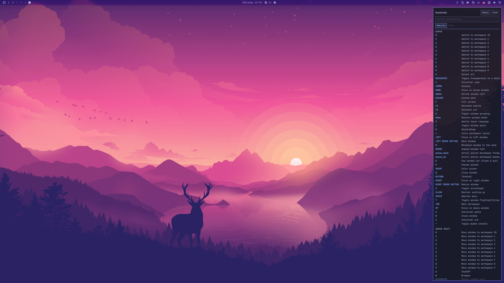

# Keycheat

An Omarchy shell plugin that keeps the keybinding cheat sheet at the outer edge
of the screen — the right edge on a single monitor. It stays hidden until the
pointer touches that edge, then slides out, themed by the running Omarchy theme.
Pin it to keep it open.

Two tabs share the panel: **Omarchy** (the compositor's bindings) and **Tmux**.
It reads `omarchy menu keybindings --print` and
`omarchy-menu-tmux-keybindings --print`, so it shows every binding those menus
show, including your own additions in `~/.config/hypr/bindings.lua` and
`~/.config/tmux/tmux.conf`, and reloads when either changes.



## Requirements

- Omarchy Quattro (the shell plugin system and `omarchy-shell` IPC)
- Nothing else: the panel runs inside the existing `omarchy-shell` process.

The two listings come from commands Omarchy already ships, so there is nothing
extra to install:

- `omarchy menu keybindings --print` — the compositor's bindings
- `omarchy-menu-tmux-keybindings --print` — the tmux bindings

## Install

```bash
omarchy plugin add https://github.com/JReis23/omarchy-keycheat --enable
```

`omarchy plugin add` clones the repository into
`~/.config/omarchy/plugins/jr.keycheat`, enables it, and `omarchy plugin update
jr.keycheat` brings later commits in. If you prefer to install by hand, put the
repository in that same folder, run `omarchy-shell shell rescanPlugins`, then
`omarchy plugin enable jr.keycheat`.

Enabling writes the plugin into `~/.config/omarchy/shell.json`. To turn it off
without deleting it:

```bash
omarchy plugin disable jr.keycheat
```

To remove it completely (the panel disappears and its reserved space goes with
it):

```bash
omarchy plugin remove jr.keycheat
```

## Usage

- Move the pointer to the right edge of the screen: the panel slides out.
  With two monitors side by side it opens outwards instead: the left screen's
  panel comes out of its left edge, the right screen's out of its right edge.
  Stacked screens keep it on the right whatever their widths, and in a row of
  three or more the screen in the middle does not open on hover — the seams
  between screens never do, so moving the pointer from one monitor to the other
  does not make the panel flicker.
- Move away: it slides back after a moment.
- **`SUPER + F1`** opens the panel on the focused screen with the search field
  ready (press it again to close the search); **`SUPER + F2`** pins that screen. Both
  need the binds from [Keybind](#keybind) below.
- **Tabs** (under the search field): `Omarchy` shows the compositor's bindings,
  `Tmux` shows tmux's. The search only looks inside the tab you are on.
- **Search** (top of the panel): click the field, or press the keybind below, and
  type. It filters on the modifier, the key and the description. `Escape` clears
  the text, then closes the panel. The query is kept if the panel hides, so
  hovering it again brings the same results back.
- **Keyboard**, while the field has the keyboard: `↑`/`↓` scroll one row,
  `PageUp`/`PageDown` a screenful, `Home`/`End` jump to either end, and
  `Tab`/`Shift + Tab` switch between the Omarchy and Tmux tabs without leaving
  the field. The count beside the tabs says how many of the listings match, and
  a thin bar on the right shows where you are.
- **Pin**: keeps the panel open **on that screen only** and reserves its width,
  so the tiling layout makes room instead of covering the windows. Other
  screens are untouched. The pin is remembered per screen, so it survives
  `omarchy restart shell` and a logout.
- **Hide**: unpins that screen and lets the panel slide away.

Hovering a row wraps its description instead of truncating it.

The card uses the same inset as the tiled windows (`gaps_out + border_size`), so
its outline lines up with theirs instead of floating over the edge.

### Keybind

Hyprland's directional focus (`SUPER + arrow`) only moves between windows; layer
surfaces such as this panel are not in that list, so they cannot be selected
that way. Bind the IPC commands instead:

```lua
o.bind("SUPER + F1", "Keycheat search", "omarchy-shell jr.keycheat search")
o.bind("SUPER + F2", "Keycheat pin", "omarchy-shell jr.keycheat pin")
```

Add them to `~/.config/hypr/bindings.lua`. `SUPER + F1` slides the panel on the
focused screen out with the search field ready, so you can type immediately.
Press it again to close the search: an unpinned panel slides away, a pinned one
gives the keyboard back and stays pinned; **Hide** unpins it. While the field has the keyboard the panel takes it
exclusively; `Escape` (twice if there is text) gives it back, and focusing
another window does too. `SUPER + F2` pins that screen, or `omarchy-shell jr.keycheat toggle`
if you would rather have one key that toggles it.

`SUPER + arrow` keeps working while the field has the keyboard, so a search never
traps you on that screen. Hyprland refuses focus changes while a layer surface
holds the keyboard exclusively, so the panel lets go first and the move is
dispatched right after. That needs one extra bind per direction, in the same
file, next to the search bind:

```lua
-- No description, so they stay out of the keybindings list.
for _, direction in ipairs({ "left", "right", "up", "down" }) do
  o.bind("SUPER + " .. direction:upper(), nil,
    "omarchy-shell jr.keycheat leave " .. direction, { non_consuming = true })
end
```

They do not consume the key: the normal `SUPER + arrow` bind still runs, and with
no search open these do nothing. An unpinned panel slides away when you leave it
this way; a pinned one stays and keeps its reserved space. The move dispatched
after the panel lets go is always a focus move (`hl.dsp.focus`), so these binds
assume `SUPER + arrow` moves focus, as it does in Omarchy's defaults.

## Configuration

Optional overrides in `~/.config/omarchy/shell.json`, under a `keycheat` key:

```json
{
  "keycheat": {
    "width": 360,
    "opacity": 0.94,
    "pinned": false
  }
}
```

| Key | Default | Meaning |
|---|---|---|
| `width` | `360` | Panel width in pixels (clamped 240–640) |
| `opacity` | `0.94` | Background opacity (clamped 0.4–1) |
| `pinned` | `false` | Pin every screen on the first run |

The file hot-reloads on save. `pinned` is only a first-run default: from then on
the panel's own pin state wins and is stored per screen in
`~/.local/state/omarchy/keycheat.json`:

```json
{ "screens": ["DP-3"] }
```

Delete that file to fall back to the config value. The plugin never writes to
`shell.json`.

## IPC

```bash
omarchy-shell jr.keycheat toggle     # pin / unpin the focused screen
omarchy-shell jr.keycheat pin        # pin the focused screen
omarchy-shell jr.keycheat unpin      # unpin the focused screen
omarchy-shell jr.keycheat pinAll     # pin every screen
omarchy-shell jr.keycheat unpinAll   # unpin every screen
omarchy-shell jr.keycheat search     # open the focused screen's search, or close it
omarchy-shell jr.keycheat leave DIR  # give the keyboard back, then focus DIR (left/right/up/down)
omarchy-shell jr.keycheat refresh    # re-read the bindings
```

## How it works

- `manifest.json` declares `kinds: ["service"]`; the shell mounts `Service.qml`
  at startup.
- `Service.qml` reads the bindings once, parses them with `Binds.js`, and owns
  the per-screen pin state, persisted in
  `~/.local/state/omarchy/keycheat.json` so a shell restart does not lose it. It
  listens for Hyprland's `configreloaded` event so a binding edit shows up
  without a restart, and for `activewindowv2` so a search stops holding the
  keyboard when another window takes the focus. Only a change of window address
  counts: Hyprland repeats the event when the active window merely retitles
  itself, and that must not close a search.
- The Tmux tab runs `omarchy-menu-tmux-keybindings --print`, which parses the
  config in a throwaway tmux server, and watches `$TMUX_CONF` (default
  `~/.config/tmux/tmux.conf`) so an edit refreshes the tab. Sourcing the config
  runs any `run-shell`/`if-shell` lines it has, so this only happens at start,
  when that file changes, on `refresh`, or on reveal after a failed read — not
  on every Hyprland reload. It reuses the same
  row renderer: `Binds.parseTmux` and `Binds.groupTmux` only differ in ordering,
  with the prefix table first, the root-table binds next and copy mode last.
- `Panel.qml` is one `PanelWindow` per screen: anchored top/bottom and to the
  side `Screens.js` picks for it, layer `Top`, `exclusiveZone` equal to its
  width while pinned and `0` while hidden. The surface stays mapped and only
  slides its card off-screen, so revealing it is instant.
- `Screens.js` turns the monitor geometry into a side and a flag per screen,
  looking only at that screen's own neighbours (screens touching its left or
  right edge and sharing some of its height). A screen with a neighbour only on
  its right faces left, every other one faces right, and the strip exists only
  when the chosen edge is not a seam. A screen in the middle of a row still
  exists for the keybind, the IPC and the pin, it just does not grab the pointer.
- While hidden, the layer surface's input region (`mask`) is a thin strip at the
  edge, so clicks and scrolls reach the windows underneath. No screen space is
  reserved and tiled windows keep their width.
- The search field filters in `Binds.js` (`filter`). Keyboard focus
  (`WlrKeyboardFocus.Exclusive`) is only taken while a search is active, because
  `OnDemand` cannot be granted to a programmatic request; a short retry timer
  nudges focus once the compositor hands the keyboard over.
- Because `Exclusive` also makes Hyprland refuse every window focus change, the
  `leave` IPC releases the keyboard and only then dispatches
  `hl.dsp.focus({ direction = … })`. The `non_consuming` binds are what call it,
  so the user's own `SUPER + arrow` bind keeps working when no search is open.

## Development

```bash
node --test test/*.test.mjs           # parsing, grouping, screen layout, manifest
omarchy plugin validate .             # the shell's own manifest check
```

The GitHub Actions workflow runs the same tests on every push and pull request,
including the manifest checks that mirror the validator.

Saving a file under `~/.config/omarchy/plugins/jr.keycheat/` reloads the plugin.
If a change does not apply, force it:

```bash
omarchy-shell shell rescanPlugins
```

## Troubleshooting

**The panel never appears.** Check that the plugin is enabled and that the
listing works:

```bash
omarchy plugin list | grep keycheat
omarchy menu keybindings --print | head
```

Then move the pointer to the *outside* edge of the desktop — with two monitors,
the left screen's left edge and the right screen's right edge. The seam between
screens deliberately does nothing. After a QML change, `omarchy restart shell`;
errors land in `journalctl --user -t omarchy-shell`.

**`SUPER + F1` or `SUPER + F2` does nothing.** They are binds you add yourself
(see [Keybind](#keybind)). Confirm `~/.config/hypr/bindings.lua` has them, run
`hyprctl reload`, and try the IPC directly:

```bash
omarchy-shell jr.keycheat search
```

If that works, the bind is the problem, not the plugin.

**`SUPER + arrow` does not leave the search.** The four `non_consuming` binds
must be present and Hyprland must accept Lua dispatchers (0.56+). Test one
directly:

```bash
hyprctl dispatch 'hl.dsp.focus({ direction = "left" })'
```

Without them the arrow stays with the field; `Escape` still gives the keyboard
back.

**The Tmux tab is empty.** `omarchy-menu-tmux-keybindings --print` only lists
binds your config declares, because Omarchy's helper removes tmux's stock binds.
A config with no `bind` lines has nothing to show. It also needs `tmux`
installed.

**The pin came back after a restart, or did not stick.** The config `pinned`
value only seeds the first run. From then on
`~/.local/state/omarchy/keycheat.json` is authoritative; delete it to go back to
the config value. Removing the plugin does not delete it, so a reinstall
restores the same pins.

**Search finds nothing.** Matching is a plain case-insensitive substring over
the modifier, the key and the description, in the current tab only. `SUPER` is
spelled `SUPER`, not `Win` or `Meta`.

## Limitations

- One panel per screen, with the pin tracked per screen.
- A screen with neighbours on both sides has no hover strip: reach it with the
  keybind, the `search` IPC or the pin, or it would open whenever the pointer
  crossed the seam.
- Two side-by-side monitors open outwards, so the panel on the left screen is on
  the left. In a row of three the left end opens on the left, the right end on
  the right; stacked screens keep it on the right.
- Pins are remembered by connector name (`DP-3`, `eDP-1`). A dock or cable that
  brings the same monitor back under another name starts it unpinned.
- Layer surfaces cannot be selected with `SUPER + arrow`; use the `search` IPC
  (see Keybind above).
- Leaving a search with `SUPER + arrow` needs the extra `leave` bind in
  `~/.config/hypr/bindings.lua`; without it the arrow is swallowed while the
  field holds the keyboard.
- While a search holds the keyboard it is exclusive, so `Escape`, `SUPER + arrow`
  or focusing another window is what gives it back.
- Rows are read from `omarchy menu keybindings --print`; a bind without a
  description is not listed there either.
- The Tmux tab shows what `omarchy-menu-tmux-keybindings --print` shows, so a
  tmux bind needs a note (`bind -N "…"`) to be listed, and binds from plugins or
  a live server's runtime changes are not picked up — only what the config file
  declares.

## License

MIT
